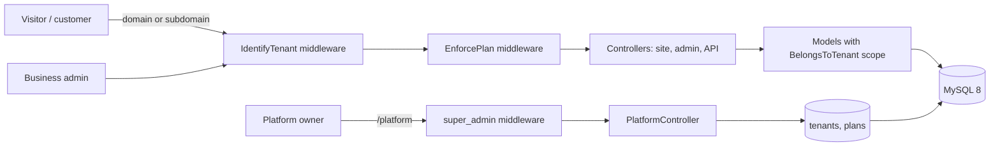

# Booking SaaS

[](https://github.com/SakhrWahib/booking-saas/actions/workflows/ci.yml)


A multi-tenant booking platform for service businesses: salons, clinics, car wash, pet grooming, cleaning, and sports courts. One installation serves many businesses, each with its own domain, branding, staff, services, and subscription plan.

## Features

**Platform (SaaS owner)**
- Owner dashboard at `/platform`: MRR, active tenants, subscriptions that expire soon
- One-step tenant onboarding: creates the business, its manager, default working hours, and settings
- Plans with feature flags (coupons, invoices, loyalty, reports, abandoned carts, mobile app) enforced by middleware
- Expired subscriptions lock the dashboard (HTTP 402) without losing data

**Multi-tenancy**
- `tenant_id` on 13 tables, isolated through the `BelongsToTenant` global scope
- Tenant resolved by custom domain or `slug.central-domain` in the `IdentifyTenant` middleware
- `unique` and `exists` validation rules scoped to the current tenant
- Per-tenant branding (name, business type, colors, logo, contact) with its own cache

**Booking engine**
- One availability engine shared by the dashboard, the public site, and the API
- Slot capacity: individual providers take 1 booking, teams take their capacity
- Staff time off, weekly schedules, and paid bookings that reserve the slot (no double booking)
- Calendar view filtered by provider and colored by status

**Business dashboard**
- Bookings with status tabs, filters, quick actions, and search by phone
- Customers, services, providers, coupons, invoices, loyalty, and reports
- Role-based permissions that also drive the sidebar menu
- RTL and LTR layouts, mobile friendly

## Architecture



## Tech stack

Laravel 13 · PHP 8.3 · MySQL 8 · Sanctum 4 · Blade · Tailwind 3 · Vite · PHPUnit 11 · GitHub Actions · Dev Containers

## Getting started

### GitHub Codespaces (no local setup)
1. **Code → Codespaces → Create codespace on main**
2. Wait for `.devcontainer/setup.sh` to install packages, start MySQL, run migrations and seeders, and build the frontend.
3. Open port **8000** from the Ports tab. The admin panel is at `/admin/login`. Set `ADMIN_EMAIL` and `ADMIN_PASSWORD` in `.env` before seeding, or the seeder prints a random password once.

If the server stops: `php artisan serve --host=0.0.0.0 --port=8000`

### Local
Requires PHP 8.3, Composer, Node 20, and MySQL 8.

```bash
composer install
npm ci && npm run build
cp .env.example .env && php artisan key:generate
php artisan migrate --seed
php artisan serve
```

## Testing

```bash
php artisan test
```

The suite covers tenant isolation, slot availability and capacity, platform plans and limits, settings, and a smoke test that opens every GET route as a guest and as an admin. CI runs it on MySQL 8 for every push.

## SMS

No SMS provider is connected. OTP codes and booking notifications are written to `storage/logs/laravel.log`. To connect a provider, implement `send()` in `app/Services/SmsService.php`.

## Roadmap

- [x] Unified dashboard design system
- [x] Staff time off and slot capacity
- [x] Multi-tenancy
- [x] Platform owner dashboard, plans, and subscriptions
- [ ] Online payments (Moyasar / Tap)
- [ ] Security hardening, performance, backups, and launch

---

## بالعربي

نظام حجوزات SaaS متعدد الأنشطة، مبني على Laravel 13. كل نشاط (صالون، عيادة، مغسلة...) له نطاقه وإعداداته وفريقه وباقته. سجل التقدم المفصّل في [PROGRESS.md](PROGRESS.md).
